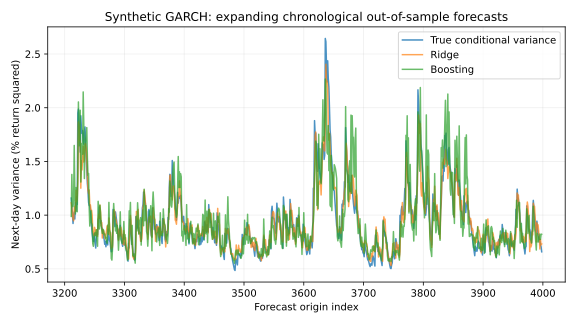

# Machine Learning for Financial Risk

Next-day variance forecasts on explicitly synthetic GARCH returns, implemented
2026-10-28 with [AI assistance](../CONTRIBUTIONS.md).

The project compares standardized Ridge regression, histogram gradient boosting,
a historical-variance baseline and a frozen pre-test constant. A synthetic oracle
is included as a diagnostic. It uses a 60/20/20 chronological split, validation-only
parameter selection, expanding refits every 100 test observations and causal
features computed using returns observed at the forecast origin.

```python
from quantlab.risk import run_research
results, dataset, forecasts, test_start = run_research(n=4000, seed=42)
print(results["metrics"]["ridge"])
```

Install and reproduce using the [root commands](../README.md). See the
[French report](docs/research_report.pdf), [editable source](docs/research_report.md),
[notebook](notebooks/research.ipynb), [all predictions](results/out_of_sample_forecasts.csv)
and [metrics](results/research.json).



The primary seed's held-out QLIKE is 0.90628 for Ridge, 0.90977 for boosting and
0.95003 for the 20-day historical baseline. These losses are not financial returns.
Across additional seeds, boosting does not consistently outperform the baseline.
The reports retain unfavorable results and conditional uncertainty intervals.

Returns are in percentage units. At origin t, the target is r[t+1]^2. Train-only
variance floors prevent invalid negative forecasts. Standardization is fitted
inside each training window. The Poisson loss is a positive-mean regression
criterion, not an assumption that squared returns follow a count distribution.

Tests modify future returns and require earlier features/predictions to remain
unchanged. Risk diagnostics include Gaussian 1% VaR, exact binomial coverage and
Kupiec likelihood ratios. Coverage tests alone do not test exception independence
or expected shortfall. No market data, trading strategy, realized profits,
regulatory validation or real-world forecasting advantage is claimed.
