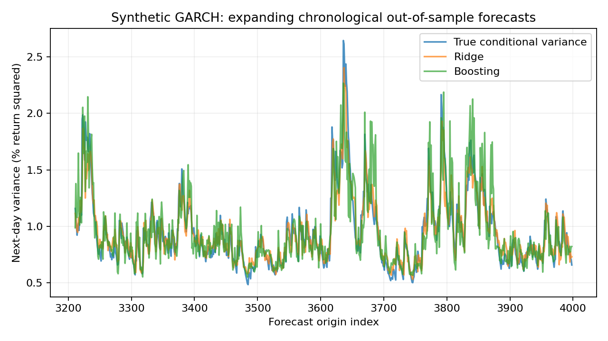

# Question de recherche et données

La question est de savoir si des modèles de régression utilisant uniquement des informations observées améliorent une prévision de variance historique simple. L'objet prévu est la variance conditionnelle du rendement du jour suivant, et non le signe du rendement ou la rentabilité d'une stratégie. Les données sont synthétiques, afin de disposer d'une variance vraie connue pour le diagnostic.

La simulation utilise un GARCH(1,1) gaussien de moyenne nulle :

$$r_t=\sqrt{h_t}\varepsilon_t,\quad h_t=\omega+\alpha r_{t-1}^2+\beta h_{t-1},\quad\varepsilon_t\sim\mathcal N(0,1).$$

Les paramètres sont $\omega=0,03$, $\alpha=0,08$, $\beta=0,89$, avec $\alpha+\beta=0,97<1$. Le processus admet une variance inconditionnelle finie $\omega/(1-\alpha-\beta)=1$. Les rendements sont en pourcentage : la valeur 1 représente un rendement de 1 %, pas de 100 %.

Un burn-in de 1 000 observations précède les 4 000 observations retenues. La variance initiale est la variance inconditionnelle, mais cela ne signifie pas que l'état initial est tiré de toute la distribution stationnaire. Le burn-in réduit l'influence de cette initialisation. La graine principale est 42 ; les graines 7 et 2026 servent à examiner la variabilité des conclusions.

À l'origine $t$, la cible est $y_t=r_{t+1}^2$. Elle est un proxy bruité mais conditionnellement non biaisé de $h_{t+1}$, puisque $\mathbb E[r_{t+1}^2\mid\mathcal F_t]=h_{t+1}$. La variance vraie est conservée pour construire un oracle pédagogique, inaccessible à un modèle exploitant uniquement des observations de marché.

Les variables explicatives sont $r_t$, $r_t^2$, $r_{t-1}^2$, et les moyennes des carrés sur 5, 20 et 60 jours se terminant à $t$. Aucune fenêtre centrée, normalisation globale, interpolation future ou valeur de cible future n'entre dans ces variables.

\newpage

# Protocole chronologique et modèles

Après construction des lags, il reste 3 940 lignes. Les 2 364 premières constituent l'apprentissage, les 788 suivantes la validation et les 788 dernières le test. La validation sert exclusivement à choisir les hyperparamètres. Le test final ne sert ni à sélectionner le modèle ni à ajuster le plancher de variance.

Le premier modèle est une régression Ridge précédée d'une standardisation dans un pipeline. La pénalité est choisie dans $\{1,10,100\}$. Le second est un gradient boosting d'histogrammes à perte de Poisson, adapté ici à une cible non négative. Le nombre d'itérations est fixé à 100, le learning rate à 0,05, le nombre maximal de feuilles à 7 et la régularisation L2 est choisie dans la même grille. L'early stopping aléatoire est désactivé.

La perte de Poisson est utilisée comme critère de régression d'une espérance positive ; les carrés de rendements ne sont pas supposés suivre une distribution de comptage de Poisson. Cette distinction évite une interprétation probabiliste incorrecte du choix algorithmique.

Après sélection, les coefficients sont réestimés sur une fenêtre croissante tous les 100 points du test, en incorporant uniquement les cibles déjà observées à l'origine du prochain bloc. Les hyperparamètres restent gelés. Le dernier résultat de la ligne d'apprentissage précédant l'origine $t$ est $r_t^2$ ; il est disponible dès que $r_t$ est observé. Aucun embargo n'est nécessaire pour cette cible à horizon un sans chevauchement, mais un horizon agrégé de plusieurs jours demanderait un examen différent.

Un plancher égal à 1 % de la moyenne des cibles d'apprentissage est imposé aux prévisions. Ce plancher prévient les variances nulles ou négatives du modèle linéaire et stabilise QLIKE. Il est calculé uniquement sur le passé. Les deux références réalisables sont la moyenne mobile sur 20 jours et une variance constante calculée sur la période antérieure au test, gelée pendant celui-ci.

Le test de causalité modifie les rendements à partir d'une date future et vérifie que toutes les variables et prévisions antérieures restent identiques. C'est un contrôle concret de fuite temporelle. Il ne remplace pas l'inspection des règles de sélection et de réentraînement.

\newpage

# Fonction de perte, incertitude et risque de queue

La perte principale est $\ell(y,v)=\log v+y/v$ pour $v>0$. Conditionnellement au passé, son espérance est $\log v+h/v$. Sa dérivée vaut $(v-h)/v^2$ : elle décroît avant $h$ et croît après, donc le minimum est atteint en $v=h$. Cette propriété justifie l'usage de QLIKE pour comparer des prévisions de variance à un proxy conditionnellement non biaisé.

La MSE est également conservée. Les carrés de rendements sont très bruités ; une bonne prévision conditionnelle ne les reproduit pas trajectoire par trajectoire. Une comparaison sur une seule réalisation peut même attribuer un meilleur score empirique à un modèle estimé qu'à l'oracle vrai. Cela ne contredit pas l'optimalité de l'oracle en espérance.

Le choix de pertes robustes au bruit des proxies est étudié dans Patton (2011), *Volatility forecast comparison using imperfect volatility proxies*, DOI : [10.1016/j.jeconom.2010.03.034](https://doi.org/10.1016/j.jeconom.2010.03.034). La démonstration élémentaire ci-dessus suffit pour la propriété utilisée ici et n'importe pas d'autres conclusions empiriques de cet article.

L'incertitude sur l'écart moyen de QLIKE au modèle historique est décrite par un bootstrap circulaire de blocs de longueur 20 avec 2 000 réplications. Les blocs préservent une partie de la dépendance temporelle. L'intervalle est conditionnel aux modèles ajustés et aux choix de protocole ; il ne réplique pas toute la sélection d'hyperparamètres et son interprétation dépend du choix de longueur de bloc.

La VaR gaussienne inférieure à 1 % est le seuil $q_{0,01,t}=N^{-1}(0,01)\sqrt{\widehat h_{t+1}}$. Une exception survient lorsque $r_{t+1}<q_{0,01,t}$. Les tests de couverture sont un test binomial exact et le rapport de vraisemblance de Kupiec. Les termes $0\log0$ sont traités par continuité pour les échantillons sans exception ou avec uniquement des exceptions.

Un bon taux moyen d'exceptions ne démontre pas leur indépendance ni une bonne estimation de l'Expected Shortfall. Les p-values binomiales supposent des exceptions iid sous le modèle nul. Le projet ne propose pas de certification réglementaire du modèle et ne transforme pas une absence de rejet en preuve d'exactitude.

\newpage

# Résultats hors échantillon

La graine 42 sélectionne une pénalité Ridge de 1 et une régularisation de boosting de 100. Les scores sont calculés sur les 788 lignes de test exclusivement.

| Modèle | QLIKE | MSE | Exceptions VaR 1 % |
|---|---:|---:|---:|
| Ridge | 0,90628 | 2,01936 | 13 |
| Boosting | 0,90977 | 2,02579 | 13 |
| Historique 20 jours | 0,95003 | 2,09342 | 17 |
| Constante antérieure au test | 0,92222 | 2,05743 | 8 |
| Oracle GARCH synthétique | 0,91255 | 2,03816 | 13 |

Sur cette réalisation, Ridge réduit QLIKE d'environ 0,04375 par rapport à l'historique. L'intervalle bootstrap conditionnel est approximativement $[-0,07127;-0,01794]$. Pour le boosting, l'écart est -0,04026 et l'intervalle environ $[-0,06379;-0,01676]$. Ces écarts sont exprimés en unités de perte, et ne sont pas des rendements financiers.

La graine 7 donne QLIKE 0,97389 pour Ridge contre 0,98491 pour l'historique, tandis que le boosting atteint 0,98829 et ne l'améliore pas. La graine 2026 donne respectivement 0,73414, 0,78348 et 0,74168. La complexité du boosting n'apporte donc pas une amélioration systématique par rapport à une régression linéaire ou à une référence simple.

Pour la graine 42, les 13 exceptions de Ridge représentent 1,65 % des 788 prévisions, contre 1 % attendu. Le test de Kupiec donne une p-value d'environ 0,094 et le test binomial environ 0,072. Le faible nombre d'observations de queue rend l'estimation incertaine. Le modèle historique produit 17 exceptions et une p-value binomiale d'environ 0,0034, ce qui signale ici une couverture moyenne insuffisante sous les hypothèses du test.

La variance constante ne présente que huit exceptions sur cette graine, mais cela ne la rend pas préférable sur tous les critères : son QLIKE est supérieur à celui de Ridge et sa couverture varie fortement selon la graine. Le choix d'un modèle de risque nécessite plusieurs diagnostics, pas un seul classement.

\newpage

# Reproduction, limites et extensions

Le fichier `research.json` contient les partitions, les scores de validation, les hyperparamètres sélectionnés et tous les scores de test. `out_of_sample_forecasts.csv` conserve chaque prévision avec son origine. Les répétitions supplémentaires et les intervalles bootstrap sont également exportés. Aucune base externe ni clé d'API n'est nécessaire pour reproduire le protocole.

Les tests automatisés contrôlent la positivité des variances simulées, la reproductibilité des graines, l'alignement cible-origine, la causalité des variables et des prévisions, les cas extrêmes de backtesting et une exécution complète sur un échantillon réduit. Le contrôle de causalité porte sur les deux modèles, y compris la standardisation de Ridge.

Les résultats sont limités à une dynamique GARCH gaussienne stationnaire. Ils ne valident pas une efficacité sur des rendements réels, qui peuvent contenir des sauts, des queues épaisses, des ruptures structurelles ou une moyenne conditionnelle non nulle. Les chiffres de QLIKE dépendent de l'unité des rendements par un décalage additif, donc seuls les modèles utilisant les mêmes données et unités doivent être comparés.

L'oracle est un outil pédagogique. Sur les données réelles, la variance conditionnelle n'est pas directement observable ; il faudrait définir un proxy, traiter les jours non ouvrés et documenter les ajustements des prix. Une expérience sur un seul actif sélectionné après examen des résultats présenterait aussi un risque de sélection.

Une extension rigoureuse inclurait un benchmark GARCH estimé, plusieurs actifs et régimes prédéfinis, une séparation chronologique imbriquée, une analyse de stabilité et des tests de dépendance des exceptions. Un protocole de production demanderait en plus une surveillance de la dérive, une journalisation des prévisions et des règles de réentraînement définies avant observation des résultats.

Ce projet démontre un protocole exécutable de recherche sur la variance, avec contrôles de fuite temporelle et restitution des résultats défavorables. Il n'établit pas de profit exploitable et ne revendique pas une expérience d'utilisation en entreprise.

\newpage

# Annexe : prévisions et variance vraie

{width=100%}

La représentation compare des variances conditionnelles et non des prix ou rendements de stratégie. La variance cible observée à un seul jour est un carré de rendement très bruité. Les scores agrégés et les répétitions sur d'autres graines complètent donc la lecture du graphique.
