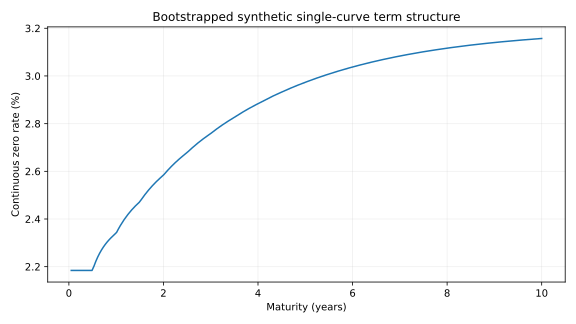

# Interest Rate Analytics

A synthetic single-curve fixed-income research project, implemented 2026-10-28
with [AI assistance](../CONTRIBUTIONS.md).

The library implements positive discount curves with log-linear interpolation,
no extrapolation, simple-deposit/par-swap bootstrapping, bond and spot-starting
swap valuation, parallel zero-rate PV01, dollar duration and dollar convexity.
Each swap bootstrap step must add exactly one previously unknown coupon date.

```python
from quantlab.rates import bootstrap, par_swap_rate, bond_pv, risk_measures
curve = bootstrap([(.5, .025), (1., .027)], [([.5, 1., 1.5], .03)])
rate = par_swap_rate(curve, [.5, 1., 1.5])
value = bond_pv(curve, [.5, 1., 1.5], coupon_rate=.035, notional=100)
risk = risk_measures(lambda c: bond_pv(c, [.5, 1., 1.5], .035), curve)
```

Install and reproduce using the commands in the [root README](../README.md).
The [French report](docs/research_report.pdf), [source](docs/research_report.md),
[notebook](notebooks/research.ipynb) and [raw results](results/) include conventions,
derivations, quote repricing, negative-rate tests and analytical zero-coupon risk checks.



Maximum observed input-rate repricing error: about 8.0e-17. The illustrative
five-year bond price is 102.40834 per nominal 100. Its signed PV01 is -0.04745.
The five-year par swap rate is about 2.98041% on the synthetic semiannual grid.

Time is supplied in years with accruals equal to adjacent differences. A PV01 is
the central sensitivity to a +1bp shift of continuously compounded ZERO rates,
not a quote bump and rebootstrap. Negative rates and discount factors above one
are permitted. Valuation is at inception/on a coupon date, with no accrued interest.

No calendar, OIS/multi-curve basis, credit, collateral or real-market calibration
is implemented. The evidence demonstrates the conventions shown, not general
production fixed-income pricing capability.
