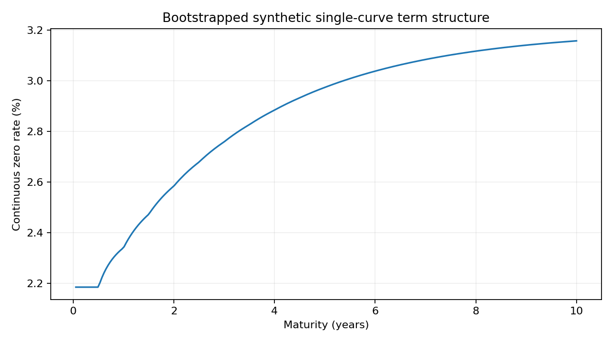

# Objectif et conventions

Ce projet construit une courbe d'actualisation à partir de dépôts et de swaps au pair, puis valorise des obligations et des swaps et mesure leur sensibilité aux taux. Il étudie la propagation des conventions financières jusque dans les calculs numériques. Les cotations sont entièrement synthétiques et ne représentent aucun marché réel.

Le facteur d'actualisation $D(t)$ est le prix à la date zéro d'un paiement certain d'une unité à la date $t$. On impose $D(0)=1$ et $D(t)>0$. Les taux négatifs sont autorisés, donc $D(t)\le1$ et la décroissance de $D$ ne sont pas imposés comme contraintes universelles. Les échéances sont données en années et les périodes de coupon sont les différences des échéances fournies.

Le taux zéro continu est $z(t)=-\log D(t)/t$ pour $t>0$. Entre deux noeuds, le logarithme des facteurs est interpolé linéairement. Pour $t\in[t_i,t_{i+1}]$ et $w=(t-t_i)/(t_{i+1}-t_i)$,

$$D(t)=\exp[(1-w)\log D(t_i)+w\log D(t_{i+1})].$$

L'interpolation conserve la positivité. Elle implique un taux forward instantané constant par intervalle, qui peut présenter des discontinuités aux noeuds. Le moteur interdit l'extrapolation au-delà du dernier noeud afin de rendre visible une hypothèse qui pourrait autrement être implicite.

Les instruments sont spot-starting à la date zéro, sans frais, défaut ou échange de collatéral modélisé. Le projet utilise une même courbe pour projeter et actualiser. Il ne représente donc pas un cadre multi-courbes moderne avec basis, OIS et conventions calendaires réelles.

Le calendrier de référence est semestriel jusqu'à dix ans. La courbe synthétique source possède un taux zéro $z(t)=0,02+0,012(1-e^{-t/3})$. Les dépôts à six mois et un an, puis les swaps de maturité croissante, sont calculés à partir de cette courbe. Le bootstrap reçoit seulement ces cotations, pas les facteurs d'actualisation vrais.

\newpage

# Bootstrap et formules de valorisation

Un dépôt de taux simple $L$ sur $[0,T]$ échange une unité aujourd'hui contre $1+LT$ à l'échéance. L'absence d'arbitrage impose

$$D(T)=\frac{1}{1+LT},$$

sous réserve d'un dénominateur strictement positif. Pour un swap spot-starting à dates $t_1,\ldots,t_n$, les accruals sont $\alpha_i=t_i-t_{i-1}$. En mono-courbe, le taux forward simple est

$$F_i=\frac{D(t_{i-1})/D(t_i)-1}{\alpha_i}.$$

Ainsi, la valeur de la jambe variable par unité de nominal se télescope :

$$\sum_{i=1}^n\alpha_iF_iD(t_i)=\sum_{i=1}^n[D(t_{i-1})-D(t_i)]=1-D(t_n).$$

La jambe fixe de taux $c$ vaut $cA$, où l'annuité est $A=\sum_i\alpha_iD(t_i)$. Le taux au pair est donc $c_{par}=(1-D(t_n))/A$. Si les facteurs des dates antérieures sont déjà connus, la nouvelle inconnue est isolée :

$$D(t_n)=\frac{1-c_{par}\sum_{i<n}\alpha_iD(t_i)}{1+c_{par}\alpha_n}.$$

L'implémentation exige que chaque nouveau swap n'ajoute qu'une seule date de paiement inconnue. Cette restriction rend le bootstrap transparent et évite de prétendre résoudre un problème à plusieurs inconnues sans règle d'interpolation supplémentaire. Le moteur rejette un numérateur ou dénominateur non admissible.

Le swap payeur fixe de nominal $N$ possède une valeur $N[1-D(t_n)-cA]$ ; le receveur fixe possède la valeur opposée. Une obligation à coupon annualisé $c$ et remboursement du nominal vaut $N[cA+D(t_n)]$. La valorisation est faite à une date de coupon initiale, avec intérêt couru nul : prix propre et prix sale coïncident dans ce protocole.

Un test de repricing compare chaque cotation d'entrée au taux recalculé après bootstrap. Un second contrôle compare les facteurs retrouvés à la courbe source synthétique. Il s'agit de deux vérifications différentes : un bootstrap peut reproduire ses instruments tout en dépendant fortement d'une convention d'interpolation entre leurs dates.

\newpage

# Risque de taux et expériences

Les sensibilités portent sur un déplacement parallèle $b$ des taux zéro continus : $D_b(t)=D(t)e^{-bt}$. Ce déplacement n'est pas une hausse uniforme des cotations de dépôt et de swap suivie d'un nouveau bootstrap. Les deux définitions produiraient des sensibilités différentes et doivent être distinguées.

Pour une fonction de valeur $P(b)$, le projet estime

$$P'(0)\simeq\frac{P(h)-P(-h)}{2h},\qquad P''(0)\simeq\frac{P(h)-2P(0)+P(-h)}{h^2}.$$

La dollar duration vaut $-P'(0)$ et la dollar convexity vaut $P''(0)$. La PV01 signée vaut $10^{-4}P'(0)$ : elle représente approximativement le changement de valeur sous une hausse de un point de base. Les valeurs ne sont pas normalisées par le prix. Cela permet de traiter un swap au pair de valeur nulle sans division par zéro.

L'expérience de référence utilise une obligation de nominal 100, coupon de 3,5 % et maturité cinq ans, ainsi qu'un swap payeur fixe au pair de nominal un million. Les taux de swap sont proches de 2,98041 % pour la maturité cinq ans. Les résultats observés sont les suivants.

| Grandeur | Obligation | Swap payeur fixe |
|---|---:|---:|
| Valeur initiale | 102,40834 | 0 |
| PV01 signée | -0,04745 | 468,03916 |
| Dollar duration | 474,50896 | -4 680 391,56 |
| Dollar convexity | 2 305,08225 | -22 827 483,41 |

Les signes sont cohérents : une hausse des taux réduit la valeur d'une obligation à flux positifs fixes et augmente la valeur d'un swap payeur fixe initialement au pair. Le tableau `scenarios.csv` compare la revalorisation exacte aux approximations de duration seule et de duration-convexité pour des déplacements de 10 à 100 points de base dans les deux sens.

Le contrôle analytique principal des sensibilités est une obligation zéro-coupon : $P=Ne^{-yT}$, $-P'=TP$ et $P''=T^2P$. Les différences finies centrales doivent reproduire ces expressions à la précision attendue pour le pas utilisé. Une étude sur plusieurs pas permet de distinguer l'erreur de troncature de l'arrondi.

\newpage

# Validation, reproduction et limites

Le plus grand écart de repricing observé sur les taux synthétiques est environ $8,0\times10^{-17}$ en taux décimal. Le plus grand écart entre facteurs reconstruits et facteurs sources est environ $1,1\times10^{-16}$. Ces chiffres proviennent d'un cas particulièrement favorable : les instruments sont générés avec les mêmes conventions que le bootstrap et sont suffisamment nombreux pour identifier les noeuds utilisés.

La suite de tests couvre le repricing, l'interpolation log-linéaire sur courbe plate, les taux négatifs, la valorisation au pair, le signe du risque payeur et les dérivées d'un zéro-coupon. Elle rejette les facteurs négatifs, les dates non ordonnées, les paiements hors courbe et les swaps ajoutant plusieurs coupons inconnus.

Les données numériques sont disponibles dans `results/`. Les colonnes conservent les unités : taux décimaux pour les cotations, points de base pour les scénarios, devise pour les valeurs. Les facteurs et taux zéro peuvent être retracés à partir de `curve.csv`. La graine n'intervient pas dans ce projet déterministe.

L'installation utilise le package commun à la racine. `python experiments/reproduce.py` reconstruit la courbe, les scénarios et la figure. `python -m unittest discover -s tests -v` contrôle les propriétés financières. Le module ne dépend ni du notebook ni des figures ; un utilisateur peut valoriser un instrument directement en Python.

Cette validation ne traite pas les jours ouvrés, les ajustements de calendrier, les décalages de fixing, les coupons irréguliers, le collateral discounting, les spreads de crédit ou les taux multi-courbes. L'absence de ces éléments est une délimitation du produit livré, pas une approximation acceptable sans examen pour des transactions réelles.

Une extension professionnelle devrait distinguer les courbes de projection et d'actualisation, définir les conventions par instrument, intégrer les cotations avec horodatage et provenance, puis étudier les sensibilités aux instruments de calibration et aux noeuds. Le présent projet fournit un cadre pédagogique reproductible pour comprendre les liens entre cotations, facteurs, valeurs et risque de taux.

\newpage

# Annexe : courbe reconstruite

{width=100%}

La courbe est croissante dans ce jeu de données choisi. Le moteur n'impose pas cette propriété comme une condition universelle d'absence d'arbitrage en présence de taux négatifs. Les écarts de repricing et les scénarios sont conservés dans les CSV.
