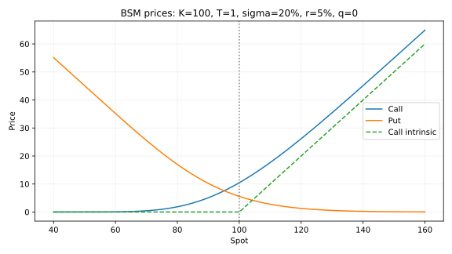

# Quant Derivatives Lab

Implemented educational pricing engines and reproducible experiments, delivered
2026-10-28 with [AI assistance](../CONTRIBUTIONS.md). The original assignment is
retained in [assignments/](assignments/01-european-options-black-scholes.md).

## Implemented

- Black-Scholes-Merton call/put pricing with continuous dividends and NumPy broadcasting.
- Expiry, zero volatility, zero spot, negative rates and invalid-input handling.
- Delta, gamma, vega, calendar theta, rho and bracketed implied-volatility inversion.
- CRR European and American trees with probability checks.
- Exact GBM Monte Carlo, independent antithetic pairs and pilot-estimated stock control.
- Arithmetic/geometric Asian and discrete up-and-out payoffs, with independent
  geometric-Asian and continuous-barrier reference calculations.
- Explicit, implicit and Rannacher-smoothed Crank-Nicolson European PDE engines.
- Heston Fourier pricing, synthetic bounded calibration from two starts, held-out
  prices, Jacobian diagnostics and an implied-volatility quote grid.
- Delta hedging with transaction costs and misspecified volatility.

## Use

Install from the [repository root](../README.md). All rates are annual continuous
decimals; maturity is remaining years, and price is per underlying unit.

```python
from quantlab.black_scholes import price, greeks, implied_vol
from quantlab.numerical import crr, monte_carlo, finite_difference

value = price(100, 100, 1, .2, rate=.05)
delta = greeks(100, 100, 1, .2, rate=.05)["delta"]
volatility = implied_vol(value, 100, 100, 1, rate=.05)
american_put = crr(100, 100, 1, .2, rate=.05, kind="put", american=True)
estimate = monte_carlo(100, 100, 1, .2, rate=.05, control=True, steps=1)
```

Greeks are per unit parameter. Theta is calendar theta. A vega per one volatility
percentage point equals the returned value times .01. Greeks reject degenerate
inputs where the smooth formula is not defined. Implied vol is scalar and rejects
unidentifiable cases. Only analytical pricing is broadcast-vectorized.

`monte_carlo(samples=n, antithetic=True)` simulates **n independent pairs**.
Pilot paths are additional. Asian monitoring excludes time zero. Barrier
monitoring includes spot and is discrete. Its confidence interval does not
measure continuous-monitoring bias. A European payoff needs only one time step.

## Evidence

[French report PDF](docs/research_report.pdf) and [editable source](docs/research_report.md),
[architecture](docs/architecture.md), [acceptance map](docs/acceptance.md),
[notebook](notebooks/research.ipynb), [oral examination guide](docs/defense.md).



For reference case A, analytical call price is 10.4505835722. The maximum
analytical-versus-independent-integration error across cases A-H is about
2.4e-14. At 800 steps the recorded CRR error is 0.00250 and the PDE error is
0.000618. Monte Carlo 95% interval coverage was 94% in 200 seeded replications.
These are results of specific experiments, not universal error guarantees.

## Limitations

The Heston inputs are synthetic, noiseless quotes generated by the same model.
Near-zero calibration errors are not evidence of fit to real markets. Surface
diagnostics apply to a discrete quote grid; no globally arbitrage-free continuous
surface is constructed. Fourier quadrature must be rechecked for new parameter
regimes. PDE results depend on domain truncation and grid resolution; explicit
central differences may fail monotonicity near a boundary for large drift.

The model excludes jumps, funding spreads, discrete dividends, collateral,
market calendars, American PDEs and continuous barrier simulation. Hedge cash
dividends use a left-point time approximation. The code is not independently
reviewed or production-certified. The original assignment's prospective version
numbers are pedagogical milestones; this delivery does not fabricate historical
release tags or claim a formal grade of 85/100.
