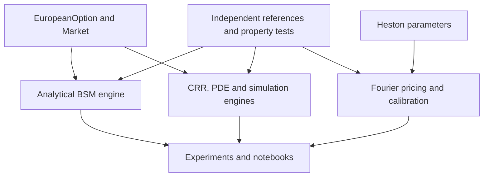

# Architecture and interfaces

The contract carries strike, maturity and payoff direction; `Market` carries
spot, volatility, continuously compounded rate and dividend yield. The public
`price` function is also available directly for NumPy broadcasting. Functional
interfaces keep numerical experiments lightweight; separate models and engines
can be added without adding plotting dependencies to the library.

The scalar numerical engines deliberately expose the same financial arguments
plus method-specific controls. They currently price only the documented payoff
families. An instrument-dispatch registry or universal abstract engine hierarchy
would add complexity without an established second contract system, so it is not
introduced in this research version. Heston is a separate validated parameter
object and Fourier pricer, not a flag inside the BSM formula.

The rate and risk modules are independent of the derivatives modules. Only
`numerical`, `heston` and `exotics` import shared BSM validation/reference functions.
Tests use independent quadrature or analytical financial identities as well as
cross-engine comparisons. Calling BSM from a reference engine is not counted as
independent validation of BSM itself.

`experiments/reproduce.py` writes tables and figures to each project's results
folder. The library never writes files or imports matplotlib. Notebooks serve
as interactive entry points. Sources and tests are packaged at repository root
to avoid duplicating dependencies across the three projects.

Potential future changes include a date/convention layer, separate market quote
objects, richer exercise schedules, and model-specific result diagnostics. No
such capability is implied by the current small dataclasses.
