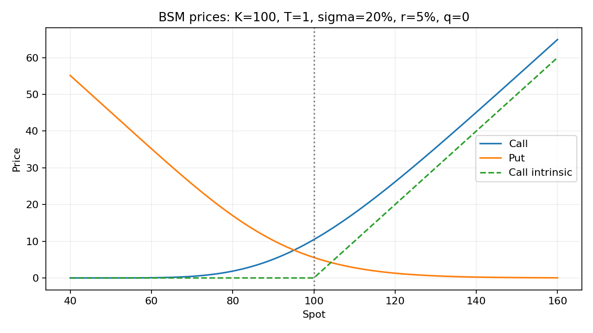
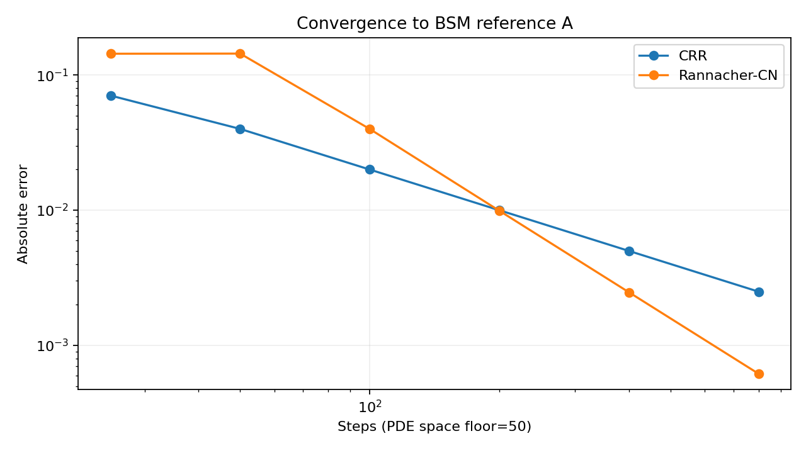
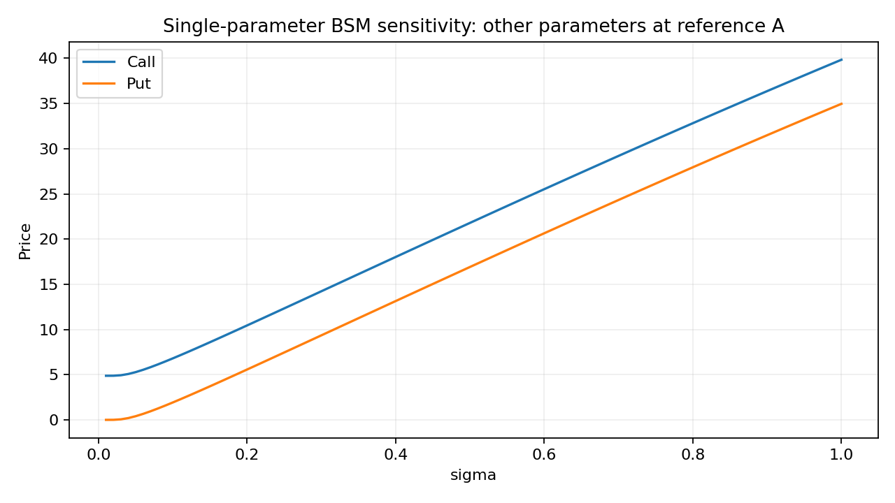
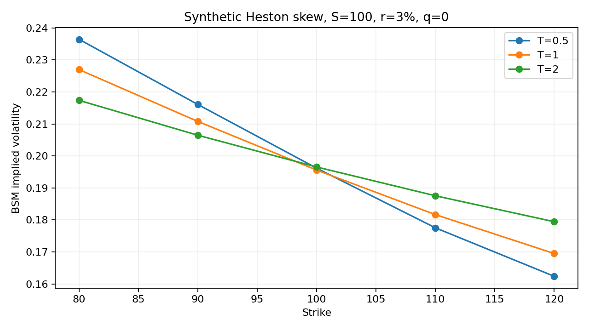

# Mission et protocole scientifique

Le projet construit une bibliothèque Python de valorisation d'options et confronte les modèles à des contrôles indépendants. La question centrale est la suivante : comment distinguer une formule correcte, une implémentation correcte et un résultat suffisamment précis pour un usage donné ? Le moteur analytique européen constitue la référence, puis les arbres, la simulation et les différences finies introduisent des erreurs de nature différente.

Les expériences sont entièrement synthétiques. Les paramètres contractuels sont des valeurs choisies pour isoler des propriétés théoriques, et non des cotations historiques. Le projet ne revendique ni validation bancaire, ni calibration sur des données de marché, ni performance de trading. Le code et cette première documentation ont été produits avec une assistance IA ; l'exécution des tests constitue un contrôle logiciel, pas une preuve de maîtrise personnelle des développements.

Le périmètre livré comprend Black-Scholes-Merton avec dividendes continus, les sensibilités, l'inversion de volatilité, les arbres CRR européens et américains, Monte Carlo avec réduction de variance, les options asiatiques et barrières, trois schémas d'EDP, une grille de volatilités implicites Heston, une calibration synthétique et la couverture delta discrète. Une grille de volatilités accompagnée de diagnostics n'est pas une interpolation continue certifiée sans arbitrage.

La chaîne de preuve associe chaque résultat à un contrôle adapté. Les formules sont comparées à une intégration gaussienne indépendante. Les méthodes approchées sont comparées au prix analytique. Les erreurs statistiques sont accompagnées d'intervalles de confiance. Les courbes de convergence sont conservées en CSV afin de pouvoir être inspectées sans refaire les graphiques.

Le scénario de référence est un call avec $S=K=100$, $T=1$, $\sigma=20\%$, $r=5\%$, $q=0$. Son prix vaut environ 10,4505835722. Tous les taux sont des taux continus annuels en décimal, les maturités sont des fractions d'année et les prix sont exprimés par unité de sous-jacent. Aucun calendrier ni convention ACT/360 implicite n'est introduit.

Les sources mathématiques primaires comprennent Black et Scholes (1973), *The Pricing of Options and Corporate Liabilities*, DOI : [10.1086/260062](https://doi.org/10.1086/260062), et Heston (1993), *A Closed-Form Solution for Options with Stochastic Volatility with Applications to Bond and Currency Options*, DOI : [10.1093/rfs/6.2.327](https://doi.org/10.1093/rfs/6.2.327). Les démonstrations ci-après explicitent le cadre utilisé par le code.

\newpage

# Mouvement brownien géométrique et conventions

On travaille sur un horizon fini avec la filtration brownienne naturelle complétée. Les coefficients sont constants. Pour $S_t>0$, la dynamique historique du prix ex-dividende est

$$dS_t=\mu S_t\,dt+\sigma S_t\,dW_t^{\mathbb P}.$$

Ici $\mu$ désigne la dérive du **prix ex-dividende**. Avec un rendement de dividende continu $q$, le rendement total instantané a pour dérive $\mu+q$. Cette convention devient essentielle lors du changement de mesure.

En appliquant Itô à $f(s)=\log s$, on obtient

$$d\log S_t=(\mu-\tfrac12\sigma^2)dt+\sigma dW_t^{\mathbb P}.$$

L'intégration entre $t$ et $T$ donne

$$S_T=S_t\exp\left[(\mu-\tfrac12\sigma^2)(T-t)+\sigma(W_T^{\mathbb P}-W_t^{\mathbb P})\right].$$

Pour justifier l'usage du logarithme, on peut arrêter le processus à sa sortie de $[1/n,n]$, appliquer Itô puis faire tendre $n$ vers l'infini. La formule exponentielle obtenue est strictement positive et satisfait l'EDS ; l'unicité forte pour les coefficients lipschitziens permet d'identifier la solution. Si $S_0=0$, la solution est identiquement nulle, un cas traité séparément dans le moteur.

Par indépendance des accroissements browniens,

$$\log(S_T/S_t)\mid\mathcal F_t\sim\mathcal N\left((\mu-\tfrac12\sigma^2)\tau,\sigma^2\tau\right),\qquad\tau=T-t.$$

Pour tout réel $p$ et un spot strictement positif, la fonction génératrice normale donne

$$\mathbb E[S_T^p\mid\mathcal F_t]=S_t^p\exp\left(p\mu\tau+\tfrac12p(p-1)\sigma^2\tau\right).$$

En particulier, l'espérance du prix est $S_te^{\mu\tau}$ et sa variance est $S_t^2e^{2\mu\tau}(e^{\sigma^2\tau}-1)$. Le rendement logarithmique moyen est $(\mu-\sigma^2/2)\tau$, tandis que le rendement simple moyen est $e^{\mu\tau}-1$. Ces deux objets ne sont donc pas interchangeables.

Les hypothèses de diffusion continue, de volatilité constante et de négociation continue excluent les sauts, les spreads, les contraintes de financement et les smiles observés. L'exactitude d'une formule dans ce modèle ne démontre pas l'exactitude du modèle pour un actif réel.

\newpage

# Réplication, autofinancement et équation de pricing

L'actif monétaire est $B_t=e^{rt}$, avec $B_0=1$. Les opérations sont sans friction, les ventes à découvert sont possibles et les stratégies considérées sont admissibles. Le dividende cumulé satisfait $dD_t=qS_tdt$.

Un portefeuille répliquant le dérivé possède $\Delta_t$ actions et une position monétaire de valeur $V_t-\Delta_tS_t$. L'autofinancement s'écrit comme une identité de gains :

$$dV_t=\Delta_t(dS_t+dD_t)+r(V_t-\Delta_tS_t)dt.$$

Il ne faut pas remplacer cette identité par $d(\Delta_tS_t)=\Delta_tdS_t$. Le rééquilibrage modifie les quantités détenues et doit être financé par le compte monétaire. L'identité de gains exprime précisément cette compensation sans apport externe.

Pour $V\in C^{1,2}$ sur $t<T$, Itô donne

$$dV=\left(V_t+\mu SV_S+\tfrac12\sigma^2S^2V_{SS}\right)dt+\sigma SV_SdW^{\mathbb P}.$$

L'identification des termes browniens impose $\Delta=V_S$. L'identification des dérives conduit ensuite à

$$V_t+\tfrac12\sigma^2S^2V_{SS}+(r-q)SV_S-rV=0.$$

La dérive historique disparaît car le risque brownien est répliqué. L'argument économique derrière l'identification au taux monétaire est l'absence d'arbitrage : une stratégie localement sans risque et autofinancée ne peut produire systématiquement un rendement distinct du placement monétaire avec un financement comparable.

La condition terminale du call est $V(T,S)=(S-K)^+$ ; celle du put est $(K-S)^+$. Le payoff présente un angle en $S=K$, donc la régularité classique ne s'étend pas jusqu'à l'échéance. La diffusion régularise le prix pour $t<T$, dans le domaine $S>0$, $\sigma>0$.

Avec un seul brownien et un actif risqué de volatilité non nulle dans une filtration brownienne, la représentation des martingales permet de répliquer les créances intégrables adaptées : le marché est complet dans ce cadre. Une filtration contenant un risque additionnel non négociable invalide cette conclusion. La seule écriture d'une EDS lognormale ne suffit donc pas à prouver la complétude de n'importe quel marché élargi.

\newpage

# Changement de mesure et représentation probabiliste

Dans la convention ex-dividende, on pose

$$\lambda=\frac{\mu+q-r}{\sigma},\qquad Z_t=\exp(-\lambda W_t^{\mathbb P}-\tfrac12\lambda^2t).$$

Sur un horizon fini, la condition de Novikov est satisfaite puisque $\lambda$ est constant : $\mathbb E[\exp(\frac12\int_0^T\lambda^2ds)]<\infty$. L'exponentielle stochastique $Z$ est donc une vraie martingale d'espérance un. On définit $d\mathbb Q/d\mathbb P|_{\mathcal F_T}=Z_T$.

Le théorème de Girsanov implique que $W_t^{\mathbb Q}=W_t^{\mathbb P}+\lambda t$ est un brownien sous $\mathbb Q$. En substituant dans la dynamique historique,

$$dS_t=(r-q)S_tdt+\sigma S_tdW_t^{\mathbb Q}.$$

Sans dividende, $e^{-rt}S_t$ est une martingale. Avec dividendes, le prix ex-dividende simplement actualisé possède une dérive $-q e^{-rt}S_t$ et n'est généralement pas une martingale. L'objet approprié est le processus de gains actualisés

$$G_t=e^{-rt}S_t+\int_0^t e^{-ru}qS_u\,du,$$

pour lequel $dG_t=e^{-rt}\sigma S_tdW_t^{\mathbb Q}$. Les moments lognormaux assurent l'intégrabilité quadratique sur l'horizon fini, donc il s'agit ici d'une vraie martingale, et non seulement d'une martingale locale.

Le dérivé européen ne distribue pas de flux intermédiaire. Pour une stratégie répliquante admissible et un payoff de croissance au plus polynomiale, son prix actualisé est une martingale :

$$V(t,S_t)=e^{-r\tau}\mathbb E^{\mathbb Q}[\Phi(S_T)\mid\mathcal F_t].$$

Cette formule se retrouve par Feynman-Kac appliqué au générateur $\mathcal Lf=(r-q)Sf_S+\frac12\sigma^2S^2f_{SS}$ et au terme d'actualisation $-rV$. L'unicité est considérée dans une classe de croissance assurant l'intégrabilité. Cela établit la cohérence entre réplication et espérance actualisée.

La mesure historique décrit les fréquences et primes de risque du modèle statistique ; la mesure risque-neutre exprime les prix compatibles avec la négociation des actifs disponibles. Il n'est pas nécessaire que les investisseurs soient réellement neutres au risque. Pour $q=0$, on retrouve $\lambda=(\mu-r)/\sigma$.

\newpage

# Formules du call, du put et cas limites

Sous $\mathbb Q$, écrivons $S_T=S\exp((r-q-\sigma^2/2)\tau+\sigma\sqrt\tau Z)$ avec $Z\sim\mathcal N(0,1)$. L'événement $S_T>K$ équivaut à $Z>-d_2$, où

$$d_2=\frac{\log(S/K)+(r-q-\sigma^2/2)\tau}{\sigma\sqrt\tau},\qquad d_1=d_2+\sigma\sqrt\tau.$$

On utilise l'identité suivante, obtenue en complétant le carré dans la densité normale :

$$\mathbb E[e^{aZ}\mathbf1_{Z>b}]=e^{a^2/2}N(a-b).$$

La décomposition $\mathbb E[(S_T-K)^+]=\mathbb E[S_T\mathbf1_{S_T>K}]-K\mathbb Q(S_T>K)$ conduit à

$$C=Se^{-q\tau}N(d_1)-Ke^{-r\tau}N(d_2).$$

L'identité de payoff $(S_T-K)^+-(K-S_T)^+=S_T-K$ donne par actualisation

$$C-P=Se^{-q\tau}-Ke^{-r\tau},$$

puis

$$P=Ke^{-r\tau}N(-d_2)-Se^{-q\tau}N(-d_1).$$

Les bornes résultent de la positivité, de la parité et de la domination du payoff par l'actif ou par $K$ :

$$\max(Se^{-q\tau}-Ke^{-r\tau},0)\le C\le Se^{-q\tau},$$
$$\max(Ke^{-r\tau}-Se^{-q\tau},0)\le P\le Ke^{-r\tau}.$$

Quand $\tau\downarrow0$, le prix converge vers le payoff. Quand $\sigma\downarrow0$ à maturité fixée, le sous-jacent risque-neutre devient déterministe, d'où $C\to\max(Se^{-q\tau}-Ke^{-r\tau},0)$, et la formule analogue pour le put. Ce n'est pas en général le payoff spot simplement actualisé.

Pour $S\downarrow0$, $C\to0$ et $P\to Ke^{-r\tau}$. Pour $S\to\infty$, $P\to0$ et $C-(Se^{-q\tau}-Ke^{-r\tau})\to0$. Les branches $S=0$, $\tau=0$ et $\sigma=0$ sont implémentées séparément : aucune division arbitraire par un petit epsilon n'est nécessaire.

\newpage

# Sensibilités, asymptotiques et inversion

En dérivant les expressions précédentes et en utilisant $Se^{-q\tau}\varphi(d_1)=Ke^{-r\tau}\varphi(d_2)$, les termes intermédiaires se compensent. Pour le call,

$$\Delta_C=e^{-q\tau}N(d_1),\quad \Gamma=\frac{e^{-q\tau}\varphi(d_1)}{S\sigma\sqrt\tau},\quad \mathcal V=Se^{-q\tau}\varphi(d_1)\sqrt\tau.$$

Le put possède $\Delta_P=-e^{-q\tau}N(-d_1)$, le même gamma et le même vega. La croissance du call, la décroissance du put et leur convexité en spot découlent des signes de ces dérivées. Les deux prix croissent strictement avec la volatilité dans le domaine non dégénéré.

Pour les taux et dividendes,

$$\rho_C=K\tau e^{-r\tau}N(d_2)>0,\quad \rho_P=-K\tau e^{-r\tau}N(-d_2)<0,$$

$$\partial_q C=-S\tau e^{-q\tau}N(d_1)<0,\quad \partial_q P=S\tau e^{-q\tau}N(-d_1)>0.$$

Le call décroît avec le strike et le put croît avec celui-ci. En revanche, la monotonie en maturité n'est pas une propriété universelle lorsque des dividendes ou des taux négatifs sont autorisés. Les expériences ne doivent pas transformer une propriété de cas particulier en règle générale. Pour un call sans dividende et $r\ge0$, la valeur est non décroissante en maturité.

La convention theta est la dérivée en temps calendaire à échéance fixe, donc $\Theta=-\partial_\tau V$. La fonction `greeks` retourne des dérivées par unité de paramètre : un vega par point de volatilité s'obtient en multipliant le vega retourné par 0,01. Les sensibilités ne sont pas définies par cette interface au point non lisse d'échéance ou aux branches dégénérées.

Le prix est une fonction continue strictement croissante de $\sigma>0$ pour $S,K,\tau>0$. Cela justifie une inversion par encadrement. Le solveur Brent accepte la borne inférieure comme volatilité nulle ; la borne supérieure d'arbitrage n'est atteinte qu'à volatilité infinie et est rejetée. À l'échéance ou pour $S=0$, la volatilité n'est pas identifiable.

Les différences finies vérifient les sensibilités mais ne sont pas exactes. Pour une différence centrée, l'erreur de troncature diminue typiquement comme $h^2$ tandis que l'arrondi est amplifié par $1/h$ ou $1/h^2$. Le fichier `gamma_steps.csv` rend visible ce compromis ; choisir systématiquement le plus petit pas est une mauvaise stratégie numérique.

\newpage

# Architecture et précision du moteur

L'architecture sépare la définition du contrat (`EuropeanOption`), les données de marché (`Market`), les moteurs analytiques et numériques, puis les expériences. Les fonctions de bibliothèque n'importent ni notebook ni outil graphique. Les expériences importent la bibliothèque ; la dépendance inverse n'existe pas.

La fonction analytique accepte les scalaires et la diffusion NumPy des dimensions. Les moteurs itératifs acceptent des paramètres scalaires : la simulation et les arbres exposent des contrôles de taille distincts. Les erreurs de domaine lèvent `ValueError`. Un débordement non représentable doit provoquer une erreur explicite plutôt qu'un prix infini silencieux.

Les contraintes sont $S\ge0$, $K>0$, $\tau\ge0$, $\sigma\ge0$, et des paramètres finis. Les taux négatifs sont autorisés. Les entrées non numériques, les dimensions incompatibles et les types d'options inconnus sont rejetés. Les dates calendaires ne sont pas converties automatiquement : l'appelant fournit la maturité résiduelle déjà calculée en années.

La soustraction directe de deux termes presque égaux peut dégrader les options très hors de la monnaie. Le moteur calcule des probabilités normales en log avec `log_ndtr`, puis une différence positive avec `expm1`. Il calcule le côté hors de la monnaie et utilise la parité pour reconstruire le côté dans la monnaie. L'annulation n'est pas éliminée dans tous les régimes possibles de float64 ; les tests documentent le domaine effectivement exploré.

Pour les références analytiques usuelles, les erreurs absolues visées sont de l'ordre de $10^{-10}$ à $10^{-12}$ selon le test. La parité sur des prix de l'ordre de cent est contrôlée avec tolérance absolue et relative. La convexité discrète possède une tolérance tenant compte des différences secondes. Ces seuils sont inscrits dans les tests et ne sont pas ajustés par le script expérimental.

La validation indépendante utilise une quadrature du payoff contre la densité normale, en séparant le seuil d'exercice. Elle évite d'appeler le moteur testé pour produire la référence. L'intégration est tronquée à une queue normale très éloignée ; pour les cas modérés du jeu A-H, cette queue est négligeable devant la tolérance. Le code ne prétend pas que ce protocole serait suffisant pour toutes les volatilités extrêmes.

Les huit cas A-H sont sauvegardés avec prix, référence et résidu de parité. L'écart maximal observé vaut environ $2,4\times10^{-14}$. Le résultat indique un accord sur ces cas ; il ne constitue pas une preuve exhaustive sur tous les réels représentables.

\newpage

# Arbres et différences finies

Dans l'arbre CRR, pour $\Delta t=T/n$, on définit $u=e^{\sigma\sqrt{\Delta t}}$, $d=1/u$ et

$$p=\frac{e^{(r-q)\Delta t}-d}{u-d}.$$

La condition $0\le p\le1$ assure une probabilité risque-neutre admissible. Le moteur rejette un arbre qui viole cette condition. Aux feuilles, on initialise le payoff. Pour une option européenne, la récurrence est $V_{i,j}=e^{-r\Delta t}[(1-p)V_{i+1,j}+pV_{i+1,j+1}]$. Pour une américaine, on prend le maximum avec le payoff d'exercice à chaque noeud.

L'arbre américain permet de comparer la valeur d'exercice anticipé à la valeur européenne. Le call sans dividende à taux positif n'a pas de prime d'exercice anticipé dans ce modèle, tandis que le put peut en avoir une. L'exercice est discret sur la grille ; le cas déterministe américain maximise les payoffs actualisés sur cette même grille.

Pour l'EDP, on introduit le temps restant $u=T-t$. L'opérateur spatial discrétisé sur $S_j=j\Delta S$ s'écrit $a_jV_{j-1}+b_jV_j+c_jV_{j+1}$ avec

$$a_j=\tfrac12[\sigma^2j^2-(r-q)j],\quad b_j=-\sigma^2j^2-r,\quad c_j=\tfrac12[\sigma^2j^2+(r-q)j].$$

Le schéma theta est $(I-\theta\Delta tL)V^{m+1}=(I+(1-\theta)\Delta tL)V^m$. Les valeurs 0, 1 et 1/2 correspondent à explicite, implicite et Crank-Nicolson. Les conditions au bord sont $C(u,0)=0$ et $C(u,S_{max})\simeq S_{max}e^{-qu}-Ke^{-ru}$, avec les conditions analogues du put.

Les systèmes tridiagonaux sont résolus sans inversion dense. Deux demi-pas implicites remplacent le premier pas Crank-Nicolson pour régulariser l'angle du payoff. Le schéma explicite impose des poids spatiaux non négatifs et $1+\Delta t b_j\ge0$. Une dérive trop forte près du bord peut rendre $a_j$ négatif indépendamment du pas temporel : augmenter uniquement le nombre de dates ne corrige pas ce problème. Le solveur rejette ce cas.

À 800 pas, l'erreur CRR observée est environ 0,00250 et celle du schéma Rannacher-CN environ 0,000618. La comparaison combine raffinement spatial et temporel ; elle ne suffit pas seule à estimer séparément les ordres dans chacune des dimensions. La troncature $S_{max}$ reste un paramètre de convergence supplémentaire.

\newpage

# Monte Carlo, réduction de variance et exotiques

La simulation utilise les incréments exacts du mouvement brownien géométrique. Pour une option européenne, une seule transition jusqu'à l'échéance suffit. Pour les payoffs dépendant du chemin, les dates observées font partie de la définition du contrat. La moyenne asiatique est prise sur $\Delta t,\ldots,T$ et exclut $S_0$.

L'estimateur est la moyenne des payoffs actualisés. Son erreur standard est calculée avec la variance empirique non biaisée et un intervalle de Student à 95 %. Lorsque l'option est antithétique, les chemins $Z$ et $-Z$ sont regroupés en une observation moyenne : ce sont les paires, non les chemins individuels, qui sont indépendantes. Le paramètre `samples` compte ces observations indépendantes.

La variable de contrôle est le sous-jacent terminal actualisé $X=e^{-rT}S_T$ d'espérance connue $Se^{-qT}$. On utilise $Y-\beta(X-\mathbb EX)$. Le coefficient optimal $\operatorname{Cov}(Y,X)/\operatorname{Var}(X)$ est estimé sur un pilote indépendant, puis fixé pour l'échantillon principal. Cela évite de confondre estimation du coefficient et estimation de l'espérance sur le même échantillon.

Le fichier `monte_carlo.csv` compare trois tailles d'échantillon, trois graines et les méthodes standard, antithétique et contrôlée. Le coût des pilotes et le nombre de chemins par paire sont inclus dans la mesure de temps. Le critère $1/(\text{temps}\times\text{erreur standard}^2)$ compare l'efficacité sur cette machine ; les chronométrages ne sont pas des invariants reproductibles bit à bit.

Sur 200 répétitions indépendantes d'un protocole contrôlé, 94 % des intervalles contiennent le prix analytique, contre une couverture nominale de 95 %. Cette différence est compatible avec la variabilité d'une estimation de couverture fondée sur seulement 200 répétitions. Un intervalle individuel n'est pas une borne garantie du prix vrai.

Pour l'asiatique géométrique discrète, la moyenne des logarithmes est normale, de moyenne $m=\log S+(r-q-\sigma^2/2)T(n+1)/(2n)$ et de variance $v=\sigma^2T(n+1)(2n+1)/(6n^2)$. Une intégration lognormale fournit une référence indépendante. Pour l'asiatique arithmétique, on exploite aussi l'identité à une seule date et l'inégalité arithmétique-géométrique sur chaque chemin.

La barrière est une up-and-out sans rebate, activée dès $S_0\ge B$. Sur des chemins imbriqués identiques, augmenter le nombre de dates de surveillance ne peut augmenter le payoff. Une référence en surveillance continue est obtenue en intégrant la probabilité de survie d'un pont brownien conditionnel au terminal : $1-\exp[-2(\log B-\log S)(\log B-\log S_T)/(\sigma^2T)]$. L'intervalle Monte Carlo mesure la variance d'échantillonnage et non l'écart entre surveillance discrète et continue.

\newpage

# Heston et grille de volatilités implicites

Le modèle risque-neutre de volatilité stochastique est

$$dS=(r-q)Sdt+\sqrt v S dW^S,\quad dv=\kappa(\theta-v)dt+\xi\sqrt v dW^v,\quad d\langle W^S,W^v\rangle_t=\rho dt.$$

Les contraintes implémentées sont $v_0,\kappa,\theta,\xi>0$ et $|\rho|<1$. La condition de Feller $2\kappa\theta\ge\xi^2$ est reportée comme diagnostic, sans être imposée : sa violation n'implique pas que le modèle CIR cesse d'être non négatif, mais modifie l'accessibilité de zéro.

La fonction caractéristique est de forme affine $\phi(u)=\exp(iu\log S+C(T,u)+D(T,u)v_0)$. L'ansatz dans l'équation de Kolmogorov donne les équations de Riccati

$$D'=\tfrac12\xi^2D^2+(\rho\xi iu-\kappa)D-\tfrac12(u^2+iu),\qquad C'=iu(r-q)+\kappa\theta D,$$

avec $C(0,u)=D(0,u)=0$. Le code utilise une représentation avec exponentielle décroissante et branche de racine carrée de partie réelle non négative pour limiter les instabilités de branche dans la zone testée.

Le prix est obtenu par une intégrale de Fourier amortie avec décalage $-i/2$. En notant $\phi_R$ la fonction caractéristique du logarithme du rendement, l'identité utilisée est

$$C=Se^{-qT}-\frac{\sqrt{SK}e^{-rT}}{\pi}\int_0^\infty\frac{\Re[e^{iu\log(S/K)}\phi_R(u-i/2)]}{u^2+1/4}\,du.$$

La borne supérieure numérique vaut 150 par défaut. Les tests comparent 150 et 250 pour le cas de référence et vérifient la limite de variance presque constante. Cette vérification locale ne certifie pas toutes les combinaisons de paramètres, en particulier les maturités très courtes et les queues extrêmes.

La calibration minimise des résidus de prix de calls sur quinze cotations synthétiques. Les paramètres vrais sont $(0,04;2;0,04;0,3;-0,7)$. Deux initialisations convergent et deux cotations supplémentaires, exclues de la calibration, servent de contrôle. Les résidus proches de la précision machine sont attendus sur ces données exactes générées par le même modèle ; ils ne démontrent pas une adéquation aux marchés.

Le conditionnement du Jacobien est d'environ 1 949 dans cette paramétrisation et ces unités. Ce nombre signale une sensibilité relative des directions locales, mais dépend de l'échelle des paramètres et ne prouve pas l'identifiabilité globale. Les CSV conservent les volatilités implicites par strike et maturité. Les diagnostics contrôlent les bornes, les spreads verticaux, la convexité et le calendrier à moneyness forward constante après interpolation. Ils ne construisent pas une surface continue sans arbitrage.

\newpage

# Couverture discrète, risque de modèle et restitution

L'expérience de couverture vend une option au prix Black-Scholes puis achète son delta. Le compte monétaire finance les rééquilibrages. À chaque date, le solde accumule les intérêts, reçoit un dividende approché par $qS_{\text{début}}\Delta t$ puis finance le changement de delta. Les coûts proportionnels s'appliquent à l'achat initial, à chaque rééquilibrage et à la liquidation finale.

Le P&L final est la richesse de couverture moins le payoff vendu, actualisée à la date initiale. Sous le modèle correctement spécifié et sans coûts, augmenter la fréquence doit réduire la dispersion liée à la couverture discrète. Cela ne garantit pas un P&L exactement nul pour chaque trajectoire finie.

Avec 10 000 trajectoires, $\sigma_{\mathrm{real}}=\sigma_{\mathrm{hedge}}=20\%$, l'écart-type du P&L passe d'environ 1,87 pour 12 rééquilibrages à 0,425 pour 252. À 252 dates, la moyenne est environ 0,00475 sans coût, contre -0,596 pour des coûts de 10 points de base. La baisse du risque de discrétisation s'accompagne donc d'un turnover plus coûteux.

Lorsque la volatilité réalisée atteint 30 % et que la couverture utilise toujours 20 %, la moyenne à 252 dates est environ -3,76. Une fréquence plus élevée ne corrige pas la prime initiale insuffisante ni l'erreur systématique de modèle. La dérive physique de cette expérience est fixée à $r-q$ pour isoler ces effets ; une étude empirique pourrait introduire un autre drift et une autre dynamique de volatilité.

La validation automatisée vérifie les propriétés financières et les cas limites, la convergence de méthodes indépendantes, les sensibilités, l'inversion, les références exotiques et la reproduction des graines. Les tests statistiques utilisent des seuils conservateurs sur des graines fixées ; leur réussite ne démontre pas une couverture asymptotique universelle. Les données brutes permettent de contrôler les conclusions sans se limiter aux figures.

L'installation se fait à la racine du dépôt. `python -m unittest discover -s tests -v` lance la validation ; `python experiments/reproduce.py` régénère les expériences après installation du package. L'environnement exact est conservé dans `experiments/environment.json`. Les notebooks sont des points d'entrée pédagogiques et ne contiennent pas les algorithmes de référence.

Les extensions à poursuivre sont une véritable interpolation de surface contrainte, la calibration sur cotations de marché datées avec conventions vérifiées, des validations de quadrature plus larges et des moteurs de production. Les fonctionnalités livrées sont utilisables comme expériences pédagogiques reproductibles. Elles ne constituent pas un moteur de valorisation industriel ou une preuve d'expérience professionnelle passée.

\newpage

# Annexe graphique : prix et convergence

{width=90%}

{width=90%}

\newpage

# Annexe : paramètres et volatilité

{width=90%}

{width=90%}
